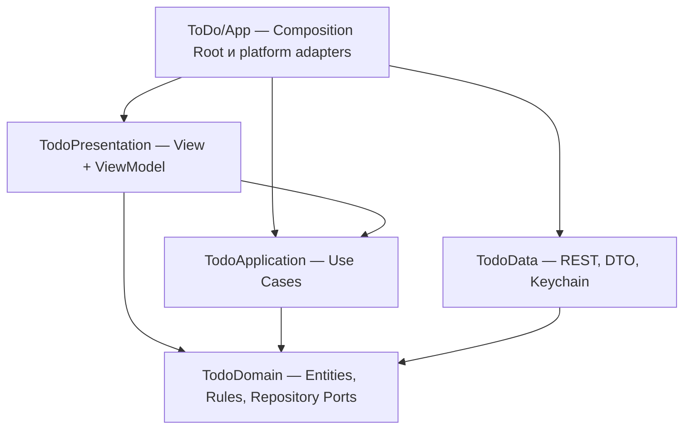

# Clean Architecture и MVVM

В проекте используются Clean Architecture на уровне приложения и MVVM внутри Presentation. Это разные уровни организации: Clean определяет границы бизнес-логики и инфраструктуры, MVVM — взаимодействие экрана с состоянием и действиями пользователя.

## Модули и зависимости

Пакет `Packages/TodoKit` содержит четыре независимых production targets. У каждого собственный Swift-модуль, а зависимости заданы в Package.swift.

| Модуль | Ответственность | Разрешённые зависимости |
| --- | --- | --- |
| TodoDomain | Todo (идентификатор `UUID`), TodoDraft, User, SessionState, бизнес-валидация, типизированные ошибки, периоды, порты репозиториев | Foundation |
| TodoApplication | Сценарии входа, регистрации, Google-входа, выхода, получения пользователя, списка и CRUD, `TodoChange`; порт внешнего identity provider | TodoDomain, Foundation |
| TodoData | `APISession` actor (токены, ротация, авторизованные запросы), `AuthAPI` и `TodoAPI` (эндпоинты и DTO), HTTPTransport, URLSession, TokenStore, Security/Keychain | TodoDomain, Foundation, Security |
| TodoPresentation | SwiftUI Views, ViewModel, состояние экранов, навигация, отображение ошибок и статусов, RU/EN строки экранов (ресурсы пакета) | TodoApplication, TodoDomain, Observation, SwiftUI, Foundation |
| ToDo/App | Создание реализаций и Use Cases, конфигурация, адаптер Google SDK, передача брендированной кнопки, Debug demo | Все необходимые внешние реализации и модули |

У Domain нет Codable, API DTO, OAuth SDK, токенов, UI-текстов или SwiftUI. Data не зависит от Presentation. Presentation не хранит репозитории и не вызывает их напрямую. Google SDK не входит в зависимости пакета: приложение реализует `GoogleIdentityProvider` и внедряет его в Use Cases. Нативная кнопка Google с текстом исходного приложения передаётся в корневой экран как UI builder.

## Путь действия пользователя

1. SwiftUI View получает ввод и вызывает метод ViewModel.
2. ViewModel обновляет loading/error/form state и вызывает нужный Use Case.
3. Use Case проверяет бизнес-правила и вызывает порт репозитория из Domain.
4. В runtime порты реализованы `AuthAPI` и `TodoAPI` из Data (оба поверх одного `APISession`) либо Debug DemoRepository.
5. Data декодирует DTO и преобразует его в entity. Возвращённые entities не содержат деталей JSON.
6. ViewModel меняет наблюдаемое состояние, SwiftUI обновляет соответствующую часть интерфейса.

ViewModel помечены `@MainActor @Observable`; SwiftUI View владеет ими через `@State` и использует binding для полей. Observation отвечает за наблюдение изменений состояния. NavigationStack, нативные DatePicker, FocusState и scenePhase остаются ответственностью UI; отдельный Coordinator для текущих трёх экранов не нужен.

Редактор возвращает результат как `TodoChange` (`saved` или `deleted`) через замыкание, а список применяет его локально через `GetTodosUseCase.applying`: тот же диапазон периода и та же сортировка, что и при загрузке, без повторного запроса. Полная перезагрузка остаётся для pull-to-refresh и возврата приложения на передний план. Редактор открывается сразу с данными из списка и обновляет задачу в фоне, не затирая правки пользователя.

Сессия публикуется как `SessionState`: `signedIn`, `signedOut` (вход не выполнен или пользователь вышел сам) и `expired` (refresh отклонён или повторный 401). При `expired` SessionViewModel показывает «Сессия истекла» уже на экране входа. Новый подписчик получает `signedOut`, поэтому уведомление не повторяется.

Строки экранов лежат в ресурсах `TodoPresentation` и читаются через `Bundle.module`, поэтому превью и тесты пакета видят переводы без приложения. В бандле App остались только строки самого приложения: экран ошибки запуска, кнопка Google и демо-данные.

## Где находятся правила

`Validation` возвращает `ValidationIssue`, а не пользовательские строки. Use Cases всегда повторно проверяют ввод перед записью, независимо от наличия интерфейса. ViewModel используют те же чистые правила для inline feedback. Перевод ошибки в текст находится только в PresentationText.swift.

SignInUseCase и RegisterUseCase нормализуют email. RegisterUseCase проверяет длину пароля и подтверждение. CreateTodoUseCase и UpdateTodoUseCase валидируют черновик и обрезают название. GetTodosUseCase вычисляет локальный диапазон периода, сортирует задачи и применяет `TodoChange` к загруженному списку. NewTodoDraftUseCase задаёт следующий полный час, а после 23:00 — 23:59 текущего дня, чтобы новая задача осталась в «Сегодня». Domain не читает текущее время неявно: у `TodoDraft` нет даты по умолчанию. Часы и часовой пояс подставляются в тестах.

Ротация токенов, HTTP-коды, retry GET, ISO-8601 и Keychain — инфраструктура Data. Отзыв токена при выходе выполняется по принципу best effort: `APISession` сначала завершает локальную сессию, а сетевые и серверные ошибки отзыва не сообщает. Ошибка Keychain по-прежнему видна. SignOutUseCase дополнительно очищает внешнюю identity session (Google) в любом случае.

`AuthUseCases` и `TodoUseCases` — неизменяемые наборы конкретных сценариев для constructor injection. ViewModel получают их, а не service locator или контейнер с доступом к инфраструктуре. Часть сценариев (`GetTodoUseCase`, `DeleteTodoUseCase`, `GetCurrentUserUseCase`, `ObserveSessionUseCase`) только передаёт вызов порту; они сохранены ради единообразия. Новые сценарии добавляются, только когда в них есть собственная логика.

`AppError` — единый словарь ошибок для всех слоёв, включая инфраструктурные `secureStorage` и `configuration`. Это осознанное упрощение для приложения такого размера: Presentation переводит любую ошибку в текст в одном месте.

`ToDo.xcodeproj` хранится в git и редактируется в Xcode без генератора. Код и ресурсы пакета Xcode подхватывает автоматически.

## Проверка границ

`python3 Scripts/check_architecture.py` читает SwiftPM manifest и проверяет граф зависимостей, импорты, отсутствие сериализации в Domain и отсутствие доступа к репозиториям из Presentation. Проверка включена в CI. Она дополняет раздельную компиляцию модулей и тесты, а не заменяет ревью поведения.

Тесты Domain проверяют правила; Application — сценарии через repository spies; Data — REST/DTO и сессию через HTTP doubles; Presentation — состояния и действия ViewModel через Use Cases, без импорта Data, UIKit или Google SDK. На macOS компилируются ViewModel, форматирование ошибок и переводы пакета; iOS Views проверяются сборкой Xcode, а для строк списка, плейсхолдеров и компонентов дизайн-системы есть `#Preview`. На iOS 26.2 прошли XCUITest-сценарии CRUD и периодов/выхода; регистрация отдельно успешно перепроверена с системной вставкой пароля, исключающей перехват событий окном AutoFill. Рабочая сборка проверена с сессией существующего пользователя локального backend.

Для справки: Apple описывает [Observation и управление данными SwiftUI](https://developer.apple.com/documentation/swiftui/managing-model-data-in-your-app), SwiftPM — [targets как отдельные модули](https://docs.swift.org/latest/documentation/packagedescription/target/). MVVM — выбранный в этом приложении паттерн Presentation; SwiftUI не требует отдельного класса ViewModel для каждого View.
