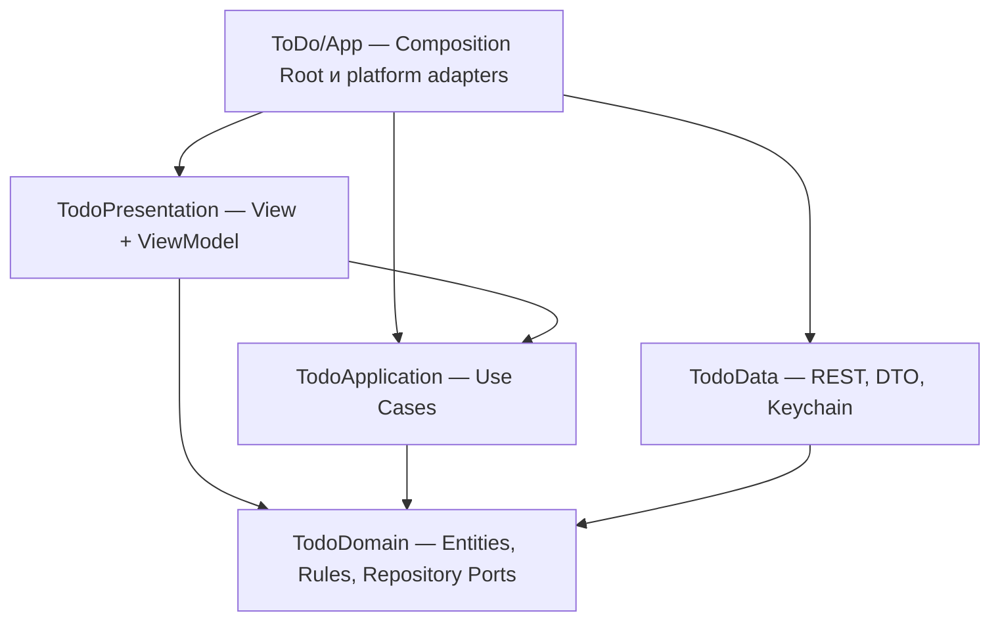

# Clean Architecture и MVVM

В проекте используются Clean Architecture на уровне приложения и MVVM внутри Presentation. Это разные уровни организации: Clean определяет границы бизнес-логики и инфраструктуры, MVVM — взаимодействие экрана с состоянием и действиями пользователя.

## Модули и зависимости

Пакет `Packages/TodoKit` содержит четыре независимых production targets. У каждого собственный Swift-модуль, а зависимости заданы в Package.swift.

| Модуль | Ответственность | Разрешённые зависимости |
| --- | --- | --- |
| TodoDomain | Todo, TodoDraft, User, бизнес-валидация, типизированные ошибки, периоды, порты репозиториев | Foundation |
| TodoApplication | Сценарии входа, регистрации, Google-входа, выхода, получения пользователя, списка и CRUD; порт внешнего identity provider | TodoDomain, Foundation |
| TodoData | APIClient actor, DTO и маппинг, HTTPTransport, URLSession, SessionTokens, TokenStore, Security/Keychain | TodoDomain, Foundation, Security |
| TodoPresentation | SwiftUI Views, ViewModel, состояние экранов, навигация, отображение ошибок и статусов | TodoApplication, TodoDomain, Observation, SwiftUI, Foundation |
| ToDo/App | Создание реализаций и Use Cases, конфигурация, адаптер Google SDK, передача брендированной кнопки, Debug demo | Все необходимые внешние реализации и модули |

У Domain нет Codable, API DTO, OAuth SDK, токенов, UI-текстов или SwiftUI. Data не зависит от Presentation. Presentation не хранит репозитории и не вызывает их напрямую. Google SDK не входит в зависимости пакета: приложение реализует `GoogleIdentityProvider` и внедряет его в Use Cases. Официальная Google-кнопка передаётся в корневой экран как UI builder.

## Путь действия пользователя

1. SwiftUI View получает ввод и вызывает метод ViewModel.
2. ViewModel обновляет loading/error/form state и вызывает нужный Use Case.
3. Use Case проверяет бизнес-правила и вызывает порт репозитория из Domain.
4. В runtime порт реализован APIClient из Data либо Debug DemoRepository.
5. Data декодирует DTO и преобразует его в entity. Возвращённые entities не содержат деталей JSON.
6. ViewModel меняет наблюдаемое состояние, SwiftUI обновляет соответствующую часть интерфейса.

ViewModel помечены `@MainActor @Observable`; SwiftUI View владеет ими через `@State` и использует binding для полей. Observation отвечает за наблюдение изменений состояния. NavigationStack, sheet, FocusState и scenePhase остаются ответственностью UI; отдельный Coordinator для текущих трёх экранов не нужен.

## Где находятся правила

`Validation` возвращает `ValidationIssue`, а не пользовательские строки. Use Cases всегда повторно проверяют ввод перед записью, независимо от наличия интерфейса. ViewModel используют те же чистые правила для inline feedback. Перевод ошибки в текст находится только в PresentationText.swift.

SignInUseCase и RegisterUseCase нормализуют email. RegisterUseCase проверяет длину пароля и подтверждение. CreateTodoUseCase и UpdateTodoUseCase валидируют черновик и обрезают название. GetTodosUseCase вычисляет локальный диапазон периода и сортирует полученные задачи. NewTodoDraftUseCase задаёт следующий полный час. Часы и часовой пояс подставляются в тестах.

Ротация токенов, HTTP-коды, retry GET, ISO-8601 и Keychain — инфраструктура Data. SignOutUseCase координирует выход из backend session и очистку внешней identity session, включая сетевую ошибку отзыва токена.

`AuthUseCases` и `TodoUseCases` — неизменяемые наборы конкретных сценариев для constructor injection. ViewModel получают их, а не service locator или контейнер с доступом к инфраструктуре.

## Проверка границ

`python3 Scripts/check_architecture.py` читает SwiftPM manifest и проверяет граф зависимостей, импорты, отсутствие сериализации в Domain и отсутствие доступа к репозиториям из Presentation. Проверка включена в CI. Она дополняет раздельную компиляцию модулей и тесты, а не заменяет ревью поведения.

Тесты Domain проверяют правила; Application — сценарии через repository spies; Data — REST/DTO и сессию через HTTP doubles; Presentation — состояния и действия ViewModel через Use Cases, без импорта Data, UIKit или Google SDK. На macOS компилируются ViewModel и форматирование ошибок; iOS Views проверяются сборкой Xcode. Полный runtime-прогон XCUITest пока не подтверждён из-за ранее обнаруженной блокировки Simulator. После перезапуска симулятора вручную проверены запуск приложения, вход существующего тестового пользователя через локальный backend и экран задач.

Для справки: Apple описывает [Observation и управление данными SwiftUI](https://developer.apple.com/documentation/swiftui/managing-model-data-in-your-app), SwiftPM — [targets как отдельные модули](https://docs.swift.org/latest/documentation/packagedescription/target/). MVVM — выбранный в этом приложении паттерн Presentation; SwiftUI не требует отдельного класса ViewModel для каждого View.
